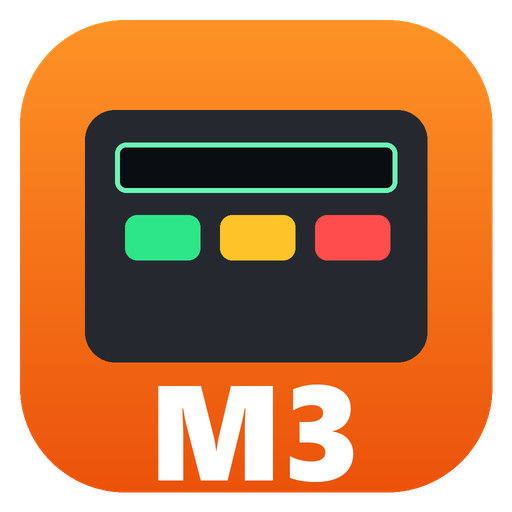
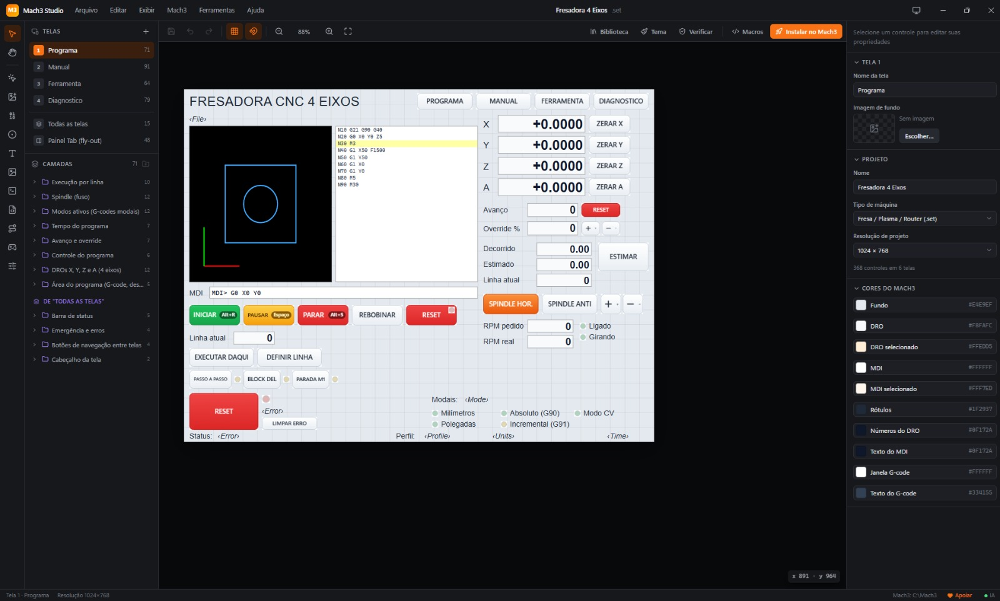
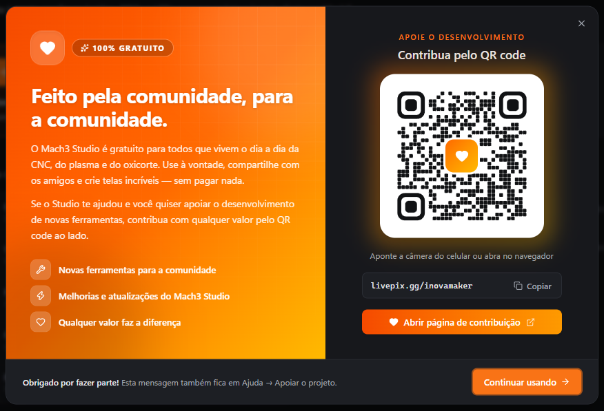

  

<h1 align="center">Mach3 Studio</h1>

  <b>Editor visual e gratuito de telas para o Mach3</b> — moderno, com tema claro/escuro, scripts, macros, 
  instalação com backup e controle por IA.

  
  

  
  
  
  

  

---

## ⬇️ Download

Baixe a versão mais recente na página de **[Releases](../../releases/latest)**:

| Arquivo | Para quem |
|---|---|
| **`Mach3-Studio-Setup-<versão>.exe`** | **Recomendado.** Instalador comum, com atalhos na área de trabalho e no menu Iniciar. |
| `Mach3-Studio-Portatil-<versão>.exe` | Roda sem instalar (pendrive). Não recomendado para uso com IA. |

**Requisitos:** Windows 10 ou 11 (64 bits). Não precisa de administrador nem de internet.
As telas criadas funcionam em **qualquer Mach3 3.x** — inclusive em PCs antigos com Windows XP/7 na máquina.

> [!NOTE]
> **"O Windows protegeu o computador"?** O instalador ainda não tem assinatura digital, então o Windows avisa na
> primeira vez. Clique em **Mais informações → Executar assim mesmo**. Baixe sempre por esta página.

---

## ✨ O que ele faz

- **Abre as telas que você já usa** (`.set` / `.lset`), inclusive telas personalizadas de plasma e oxicorte, sem perder
  nenhuma função — importar nunca altera o arquivo original.
- **Editor visual de verdade:** arrastar, redimensionar, alinhar, distribuir, grade com encaixe, zoom, camadas, travas,
  copiar/colar e até 300 passos de desfazer/refazer.
- **Todos os controles do Mach3:** botões, botões de imagem, DROs, LEDs, rótulos, imagens, linha MDI, janela de
  G-code, toolpath, jogball e barra de rolagem.
- **Funções sem decorar códigos:** catálogo das funções e códigos OEM do Mach3 com busca.
- **Scripts VB** com destaque de sintaxe, autocompletar e ajuda das funções do Mach3, e gerenciador de **macros (M-codes)**.
- **Imagens de fundo e botões com imagem**, com prévia no editor.
- **Instala direto no Mach3** com **backup automático** de tudo o que for substituído.
- **Tema claro e escuro.**
- **Funciona com IA:** Claude, Codex, Cursor e outros assistentes podem criar e editar telas pelo Studio (MCP),
  com você vendo tudo ao vivo e podendo desfazer.

---

## 🚀 Primeiros passos

1. Instale e abra o **Mach3 Studio**. Ele encontra o Mach3 em `C:\Mach3` (ou escolha a pasta em *Mach3 → Pasta do Mach3…*).
2. Clique em **Importar do Mach3** para abrir uma tela existente — ou **Novo projeto** para começar do zero.
3. Edite à vontade e salve com **Ctrl+S** (o projeto fica em uma pasta própria, com imagens e macros).
4. **Feche o Mach3** e clique em **Instalar no Mach3** (**F5**). Escolha o perfil e pronto.

O manual completo está dentro do programa: **Ajuda → Manual do usuário** (**F1**).

---

## 🤖 Usando com Inteligência Artificial

O Studio traz um servidor **MCP** (Model Context Protocol). Abra **Ajuda → Conectar assistentes de IA**, copie a
configuração pronta para o seu assistente e peça coisas como:

- *"Crie uma tela de jog com botões grandes para X, Y e Z e um DRO de cada eixo."*
- *"Deixe esta tela com visual escuro e moderno sem mudar nenhuma função."*
- *"Escreva um botão que liga a tocha, espera 2 segundos e desliga."*

Com o Studio aberto, cada alteração aparece na hora e pode ser desfeita com **Ctrl+Z**. Instalar no Mach3 sempre pede
a sua confirmação. O guia completo está em **Ajuda → Guia de uso com IA**.

---

## ⚠️ Segurança

O Mach3 controla máquinas de verdade. **Antes de produzir com uma tela nova ou alterada**, teste todos os botões com a
máquina em condição segura (sem tocha/oxigênio, sem ferramenta girando, com a emergência ao alcance).

Se algo der errado, os arquivos originais ficam guardados em `C:\Mach3\Mach3Studio-backups\<data>\`.

---

## 🧡 Apoie o projeto

<table>
  <tr>
    <td width="250" align="center">
       
      Aponte a câmera do celular
    </td>
    <td>
      <b>O Mach3 Studio é gratuito para a comunidade</b> — use à vontade e compartilhe com os amigos.  
      Se ele te ajudou e você quiser apoiar o desenvolvimento de <b>novas ferramentas</b>, contribua com
      <b>qualquer valor</b> pelo QR code ou pelo link:  
      👉 <a href="https://livepix.gg/inovamaker"><b>livepix.gg/inovamaker</b></a>  
      A contribuição é voluntária e não muda nada no programa: ele continua gratuito para todos.
      Obrigado por fazer parte!
    </td>
  </tr>
</table>

  

---

## 💬 Dúvidas, erros e sugestões

Abra uma **[Issue](../../issues)** contando o que aconteceu (versão do Studio, do Windows e, se puder, o arquivo
`.set` ou um print). Sugestões de novas ferramentas também são muito bem-vindas.

---

## 📄 Licença

O Mach3 Studio é **freeware** — gratuito, mas **não é código aberto**. Em resumo:

| ✅ Pode | ❌ Não pode |
|---|---|
| Usar de graça, em casa ou na empresa, em quantos PCs quiser | Vender, alugar ou cobrar pelo programa |
| Compartilhar o instalador original com outras pessoas | Modificar, descompilar ou redistribuir versões alteradas |
| Usar, vender e distribuir as **telas que você criar** — elas são suas | Remover os avisos de autoria e da licença |

O programa é fornecido **sem garantia**. Leia os termos completos em **[LICENSE](LICENSE)**.

Mach3 é marca de seus respectivos titulares (ArtSoft / Newfangled Solutions). O Mach3 Studio é um projeto
independente, sem afiliação, patrocínio ou endosso dessas empresas.

---

<b>English</b>

**Mach3 Studio** is a free, modern visual editor for Mach3 screensets (`.set` / `.lset`): drag-and-drop layout,
buttons/DROs/LEDs, VB scripts and macros, background images, light/dark theme, one-click install into Mach3 with
automatic backup, and AI control through MCP. Windows 10/11, interface in Portuguese.
Download it from **[Releases](../../releases/latest)**. Freeware, closed source — see [LICENSE](LICENSE).
Support development at **[livepix.gg/inovamaker](https://livepix.gg/inovamaker)**.

